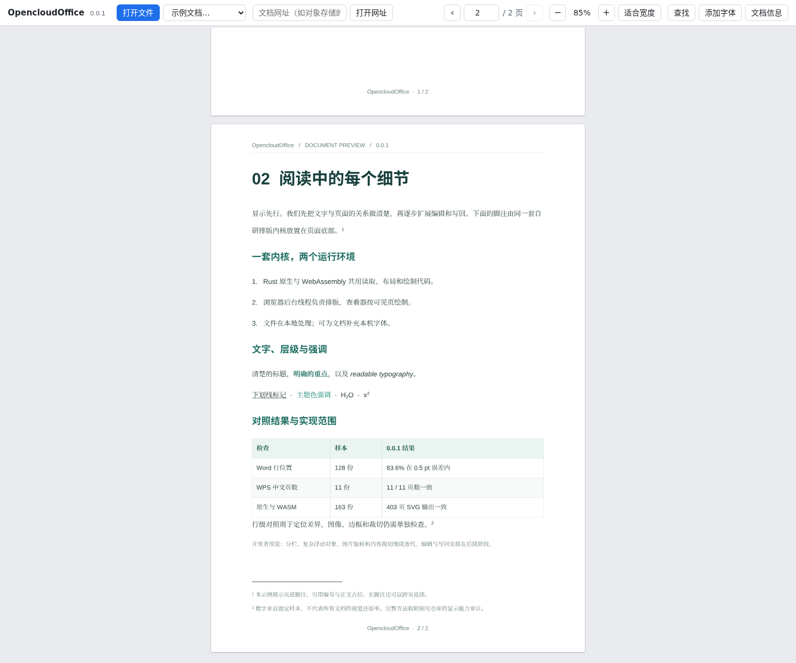

<div align="center">


# OpencloudOffice

**自研文档显示内核 · Rust 与 WebAssembly · 浏览器本地运行**

[](https://github.com/zhizhiheng/OpencloudOffice/releases/tag/v0.0.1)
[](LICENSE)
[](Cargo.toml)
[](https://github.com/zhizhiheng/OpencloudOffice/actions/workflows/ci.yml)

[**下载试用**](https://github.com/zhizhiheng/OpencloudOffice/releases/tag/v0.0.1) · [实机预览](#实机预览) · [版本亮点](#版本亮点) · [开发接入](#开发接入) · [路线图](docs/roadmap.md) · [English overview](#english-overview)

</div>

OpencloudOffice 面向需要在网页、原生应用和服务端展示 Word 文档的开发者。从读取 DOCX、解析字体到分页和绘制，使用同一套 Rust 内核；浏览器通过 WebAssembly 在本地完成处理。

**0.0.1 是首个开源开发者预览版本。** 这一版交付 DOCX 显示内核、浏览器查看器、WASM SDK 和 Linux 命令行工具，当前优先完善显示能力。

> [!TIP]
> **第一次使用？** 下载[浏览器试用包](https://github.com/zhizhiheng/OpencloudOffice/releases/download/v0.0.1/opencloudoffice-0.0.1-web.zip)，解压后启动一个本地 HTTP 服务即可体验。字体与示例已包含，无需安装 Rust。[查看步骤 ↓](#快速开始)

| 浏览器阅读 | 跨环境集成 | 核心能力自研 |
| :--- | :--- | :--- |
| 打开本地文档，查找、跳页、缩放、选择与复制文字。 | Rust 原生与 WASM 共用排版代码，输出自包含 SVG。 | ZIP / DEFLATE、XML、字体解析、文档模型与绘制在项目内实现。 |

## 实机预览

**文档预览** · 标题、图片、表格、页眉页脚在同一页面中呈现。

<p align="center">
  <a href="docs/images/preview-document.png"></a>
</p>

<table>
  <tr>
    <td width="50%" valign="top">
      <a href="docs/images/preview-search.png"></a>
      <p><strong>全文查找与高亮</strong><br />搜索整份文档，定位并跳转到匹配内容。</p>
    </td>
    <td width="50%" valign="top">
      <a href="docs/images/preview-footnotes.png"></a>
      <p><strong>文字格式与页底脚注</strong><br />在连续页面中阅读正文、编号、表格和注释。</p>
    </td>
  </tr>
</table>

以上为 Chromium 中运行发布包的实机截图。示例 DOCX 和[截图复现方法](docs/images/README.md)随仓库提供，点击图片可查看原图。

## 版本亮点

| 能力 | 0.0.1 的实现 |
| :--- | :--- |
| **文档格式与页面** | 正文、标题、编号、常规表格、页眉页脚、页码、图片与基础文本框。 |
| **脚注与尾注** | 页底脚注、跨页延续、按页或按节重新编号，以及文末尾注。 |
| **阅读体验** | 后台线程排版、按可见页绘制、全文查找、高亮、跳页、缩放、文字选择与复制。 |
| **开发接口** | Rust 内核、手写 JavaScript 接口、同步 SDK 与后台线程接口。 |
| **检查与导出** | 命令行检查格式，导出每页 SVG、行坐标和覆盖情况，辅助定位显示差异。 |

默认内核及 WASM 不依赖第三方 crate。开发用的命令行工具使用 serde 输出结构化报告。具体边界和实现依据见[排版说明](docs/layout.md)。

## 快速开始

### 1. 选择下载包

| 下载 | 适合谁 | 包内内容 |
| :--- | :--- | :--- |
| [**浏览器试用包**](https://github.com/zhizhiheng/OpencloudOffice/releases/download/v0.0.1/opencloudoffice-0.0.1-web.zip) · 推荐 | 想直接体验文档显示的用户 | 查看器、WASM、37 个开源字体文件、示例文档。 |
| [WASM SDK](https://github.com/zhizhiheng/OpencloudOffice/releases/download/v0.0.1/opencloudoffice-0.0.1-wasm-sdk.zip) | 网页与应用集成开发者 | WASM 和 JavaScript 接口，字体由调用方提供。 |
| [Linux x86_64 CLI](https://github.com/zhizhiheng/OpencloudOffice/releases/download/v0.0.1/opencloudoffice-0.0.1-linux-x86_64.tar.gz) | 自动化、批处理与服务端开发者 | 命令行工具和发布示例，字体单独提供。 |

发行包附带文件清单与许可证。需要核对下载完整性时，使用本次发布的 [SHA256SUMS](https://github.com/zhizhiheng/OpencloudOffice/releases/download/v0.0.1/SHA256SUMS)。

### 2. 启动查看器

解压浏览器试用包，在解压后的目录运行：

```sh
python3 -m http.server 8000 --bind 127.0.0.1
```

### 3. 打开第一份文档

访问 **http://localhost:8000**，在“示例文档”中选择发布手册，或拖入自己的 DOCX。文件在浏览器本地读取、排版和绘制。

> 通过 HTTP 服务访问查看器；直接双击 `index.html` 的 `file://` 方式不能加载 Worker 和 WASM。

## 开发接入

### 浏览器 SDK

将 SDK 文件与所需字体放在 HTTP 服务下，通过 `oco.js` 加载内核：

```js
import { Oco } from "./oco.js";

const core = await Oco.load("./oco.wasm");
const font = await fetch("./fonts/SourceHanSerifCN-Regular.otf");
core.addFont(await font.arrayBuffer());

const file = document.querySelector('input[type="file"]').files[0];
const doc = core.open(await file.arrayBuffer(), file.name);
document.querySelector("#page").innerHTML = doc.pageSvg(0);
doc.close();
```

字体按文档需要提供，可从浏览器试用包取得并保留其许可。完整接口见 [`web/oco.js`](web/oco.js)；异步调用见 [`viewer-client.js`](web/viewer-client.js) 与 [`viewer-worker.js`](web/viewer-worker.js)。

### 命令行

```sh
./bin/oco --version
./bin/oco render example.docx --fonts /path/to/fonts --out rendered
```

输出包括每页 SVG、行坐标和文档摘要。源码构建、格式检查、测试与项目目录说明见[开发指南](docs/development.md)。

## 验证与兼容性

以 Word 的实际输出为主要参照，WPS 作为补充；每项结果对应明确的样本和字体环境。

| 检查 | 已记录结果 |
| :--- | :--- |
| **Word 固定 PDF 基准** | 128 份文档：94.1% 断行一致，83.6% 行位置误差不超过 0.5 pt，122 份页数一致。 |
| **WPS 中文样例** | 11 份文档：80.3% 断行一致，73.7% 行位置一致，11 份页数全部一致。 |
| **原生与 WASM** | 163 份文档、403 页的 SVG 输出逐字节相同。 |
| **发布验证** | 191 项 Rust 测试及浏览器集成检查通过；发布包使用自带字体另行核对原生与 SDK。 |

行级指标用于定位换行和坐标差异，不等同于所有文档的视觉还原率。图片、边框、裁切及内容完整性另行检查；历史开发基准与发行包的字体版本可能不同。详见[还原度记录](docs/fidelity.md)和[本版验证范围](docs/releases/0.0.1.md#验证与兼容性)。

### 当前边界

| 阶段 | 范围 |
| :--- | :--- |
| **当前交付** | DOCX 阅读与显示、WASM SDK、原生命令行工具。 |
| **继续完善** | 分栏、浮动表格、旧式 VML、图片旋转、固定高度裁切、正文域和奇偶页分节。 |
| **后续阶段** | 编辑与写回；DOC 二进制解析、完整 Markdown，以及 Excel、PPT、PDF 的输入支持。 |

Markdown 当前仅逐行转换为普通段落。脚注的分栏位置、每节末尾尾注等复杂组合也仍需完善。完整问题清单与优先级见[发布说明](docs/releases/0.0.1.md#当前边界与下一步)和[路线图](docs/roadmap.md)。

## 文档与参与

| 从哪里开始 | 进一步了解 |
| :--- | :--- |
| [0.0.1 发布说明](docs/releases/0.0.1.md) · [更新记录](CHANGELOG.md) | [路线图](docs/roadmap.md) · [设计思路](docs/strategy.md) |
| [开发指南](docs/development.md) · [贡献指南](CONTRIBUTING.md) | [排版规则](docs/layout.md) · [Word 行为](docs/word-behaviour.md) |
| [提交显示问题](https://github.com/zhizhiheng/OpencloudOffice/issues) | [还原度记录](docs/fidelity.md) · [语料测试](docs/corpus-report.md) · [历史显示审计](docs/audits/display-audit-2026-11-14/README.md) |

欢迎用最小 DOCX、实际页面和预期页面帮助完善显示。`main` 用于公开维护与发版，功能开发通过独立分支和 Pull Request 进行。

## English overview

OpencloudOffice is a document rendering engine built in Rust and compiled to WebAssembly. The first open-source release focuses on DOCX preview: page layout, text, tables, images, headers, footers and notes, with a browser viewer and native command-line tools. The default core and WASM build use no third-party crates. Editing and broader format support are planned for later stages.

Download the [web viewer](https://github.com/zhizhiheng/OpencloudOffice/releases/tag/v0.0.1) to try it locally, or integrate the WASM SDK with your own fonts.

---

<p align="center">
  <strong>OpencloudOffice</strong><br />
  <a href="LICENSE">Apache License 2.0</a> · <a href="THIRD_PARTY_NOTICES.md">第三方材料与字体许可</a>
</p>
