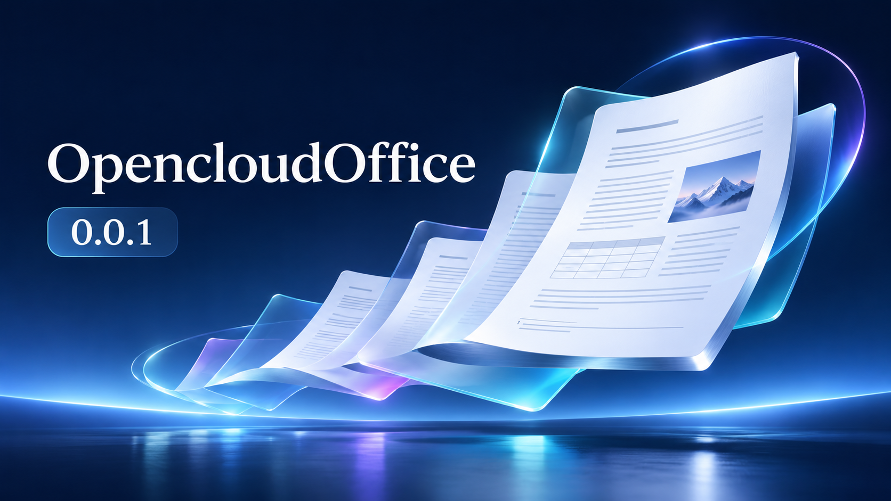
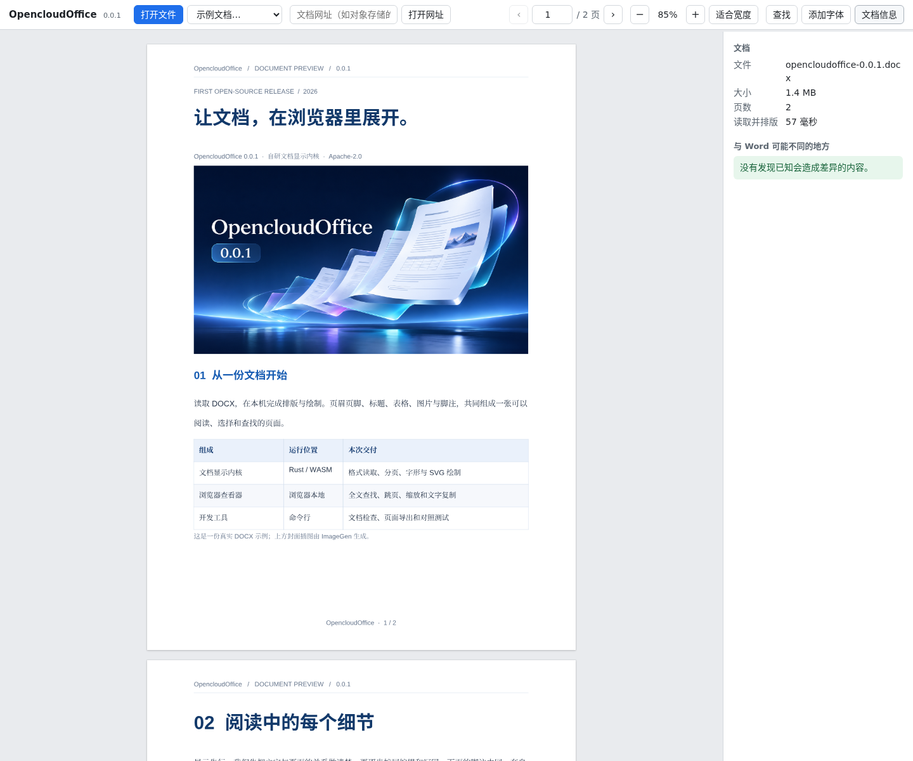
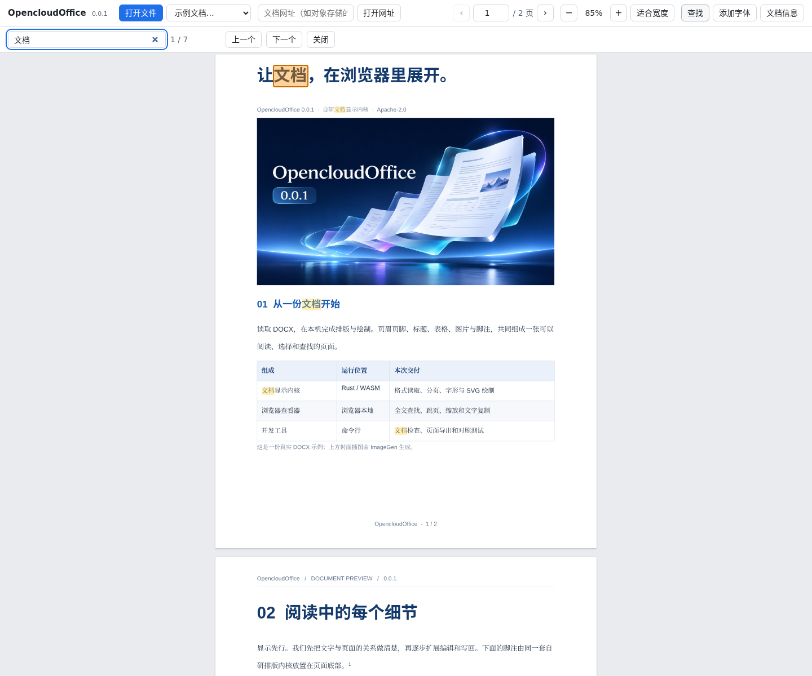
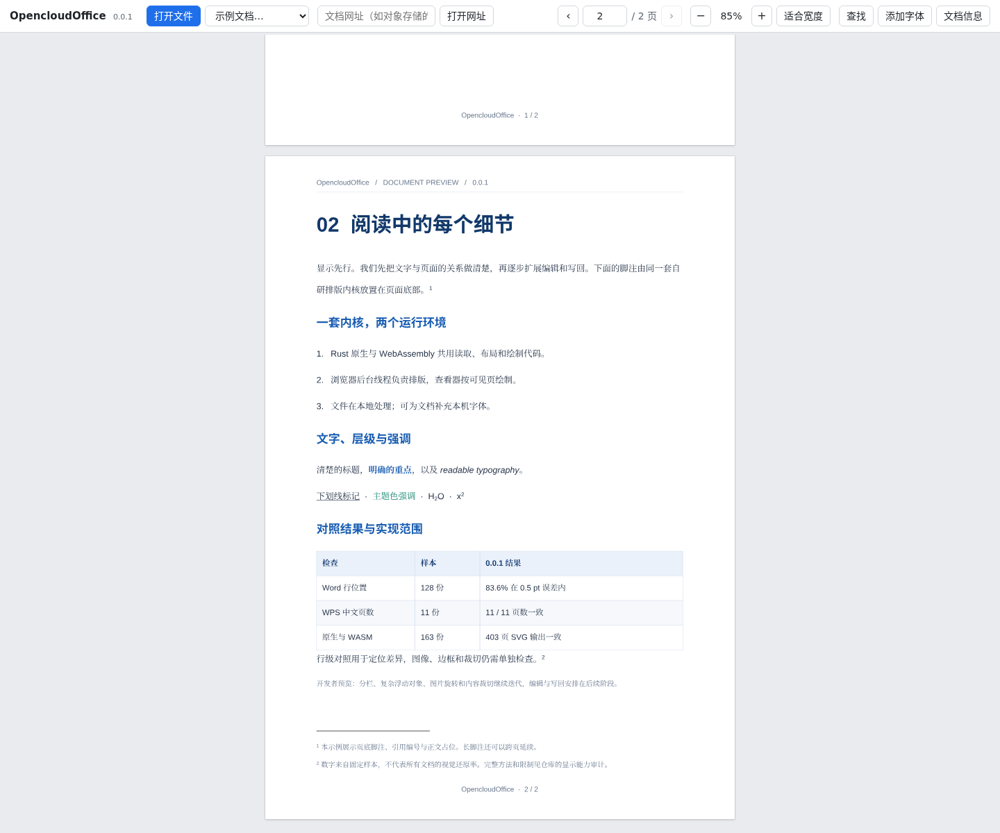

# OpencloudOffice



[](https://github.com/zhizhiheng/OpencloudOffice/releases/tag/v0.0.1)
[](LICENSE)
[](https://github.com/zhizhiheng/OpencloudOffice/actions/workflows/ci.yml)

**自研文档显示内核，让 DOCX 在浏览器和原生环境中展开。**

OpencloudOffice 用 Rust 实现格式读取、字体解析、排版和绘制，通过 WebAssembly 在浏览器本地运行。0.0.1 是首个开源的开发者预览版本，当前集中完善 DOCX 显示，编辑与写回安排在后续阶段。

[下载 0.0.1](https://github.com/zhizhiheng/OpencloudOffice/releases/tag/v0.0.1) · [发布说明](docs/releases/0.0.1.md) · [路线图](docs/roadmap.md) · [参与开发](CONTRIBUTING.md)

## 实机截图

以下截图来自 Chromium 中运行的实际查看器。展示的 DOCX 随发行包提供，截图脚本和图片来源见 [docs/images](docs/images/README.md)。

**文档预览：标题、图片、表格、页眉页脚。**



**全文查找与高亮。**



**文字格式、多级内容与页底脚注。**



## 快速试用

下载 [浏览器试用包](https://github.com/zhizhiheng/OpencloudOffice/releases/download/v0.0.1/opencloudoffice-0.0.1-web.zip)，解压后在该目录运行：

```sh
python3 -m http.server 8000 --bind 127.0.0.1
```

打开 `http://localhost:8000`，从“示例文档”中选择发布手册，或打开自己的 DOCX。包内包含 WASM、开源字体和示例，无需安装 Rust。需要 HTTP 服务；`file://` 方式不能加载后台线程与 WASM。

开发者也可下载 [WASM SDK](https://github.com/zhizhiheng/OpencloudOffice/releases/download/v0.0.1/opencloudoffice-0.0.1-wasm-sdk.zip) 或 [Linux x86_64 命令行工具](https://github.com/zhizhiheng/OpencloudOffice/releases/download/v0.0.1/opencloudoffice-0.0.1-linux-x86_64.tar.gz)。发行文件带有 SHA-256 校验值、文件清单和许可证。

## 这一版可以做什么

- **读取并显示 DOCX**：正文、标题、编号、常规表格、页眉页脚、页码、图片和基础文本框。
- **显示脚注和尾注**：页底脚注、跨页延续、按页或按节重新编号、文末尾注。
- **在浏览器阅读**：后台排版、按可见页绘制、全文查找与高亮、跳页、缩放、文字选择和复制。
- **作为内核集成**：同一份 Rust 代码编译为原生库或 WASM，输出自包含 SVG；JavaScript 接口手写。
- **检查和对照文档**：命令行工具输出格式、页面、行坐标和覆盖情况。

ZIP / DEFLATE、XML、TrueType / CFF 字体解析、文档模型、排版和绘制均在项目内实现。默认内核和 WASM 不依赖第三方 crate；开发用命令行工具使用 serde 输出报告。

## 当前范围与验证

| 格式或能力 | 0.0.1 状态 |
| --- | --- |
| DOCX 显示 | 已实现主要链路，复杂版式继续完善 |
| 二进制 DOC | 读取入口尚未实现 |
| Markdown | 当前仅逐行转成普通段落 |
| Excel、PPT、PDF | 后续计划，不属于本版输入范围 |
| 编辑、修订操作、写回 | 后续阶段 |

固定语料对照：Word 的 128 份 PDF 基准中，94.1% 的行断行相同，83.6% 的行位置在 0.5 pt 以内，122 份页数一致；WPS 12 的 11 份中文样例为 80.3%、73.7%，页数全部一致。163 份文档、403 页的原生和 WASM 输出逐字节相同。

这些是固定字体环境下的行级指标。图片方向、线型、裁切和内容完整性仍需单独检查，不能将分数当作所有文档的视觉还原率。发布包包含的字体版本与历史开发基准可能不同。分栏、浮动表格、图片旋转、内容裁切、正文域和奇偶页分节仍有缺口，具体见 [已知限制](docs/releases/0.0.1.md#已知限制)。

| 文档 | 内容 |
| --- | --- |
| [路线图](docs/roadmap.md) | 目标、技术决定和阶段计划 |
| [还原度记录](docs/fidelity.md) | 标准答案、逐文档基线和最新结果 |
| [显示能力审计](docs/audits/display-audit-2026-11-14/README.md) | 对照图、诊断样例和优化方向；记录的是脚注实现前的状态 |
| [排版说明](docs/layout.md) | 各项排版规则及依据 |
| [Word 行为](docs/word-behaviour.md) | Word 实际行为与规范的差异 |
| [语料测试](docs/corpus-report.md) | 语料来源、方法和发现的问题 |

## 开源与维护

源代码使用 [Apache-2.0](LICENSE)。第三方字体和开发依赖保留各自许可，详见 [第三方材料说明](THIRD_PARTY_NOTICES.md)。`main` 是维护与发布主分支，现有开发分支保留，欢迎通过 Issue 和 Pull Request 参与。

## 从源码构建

需要 Rust 1.88 或更高版本。

```sh
cargo run -p oco-cli -- inspect crates/oco-docx/tests/data/word-template.docx
```

输出每个段落和每段文字在套用样式继承之后的最终格式，末尾列出文档中内核尚未支持的标记及出现次数：

```
#1 P style=Heading1 ("heading 1") outline=0 before=24pt after=0pt line=1.15x
    "第一章 项目概述"  font=Calibri / 宋体 14pt bold color=365F91
    "（非粗体）"  font=Calibri / 宋体 14pt color=365F91 char-style=Strong
...
Not modelled yet (16 kinds):
    649  w:style/w:tblStylePr
    100  w:style/w:tblPr
...
```

加 `--json` 输出结构化结果。

排版并输出页面（先运行 `tools/fonts/fetch.sh` 下载开源中文字体）：

```sh
cargo run --release -p oco-cli -- render testdata/zh/07-regulation.docx --out out/regulation
```

每页写成一个 SVG，字形以轮廓形式嵌入，用浏览器直接打开即可。

在浏览器里看（需要 `rustup target add wasm32-unknown-unknown`）：

```sh
tools/web/build.sh                     # 编译 web/oco.wasm，并把字体和示例文档链接到 web/ 下
python3 -m http.server -d web 8000     # 然后打开 http://localhost:8000
```

查看器可以打开本地文件（也可以拖进来）、网址上的文件（`?file=<网址>`），可以添加本机的字体文件；侧栏列出这份文档里还不能按 Word 的样子显示的内容。文件只在浏览器里读取和排版，不上传。

在页码框输入数字后按回车可以跳页。点击“查找”或按 Ctrl/Cmd+F 可搜索整份文档，包括尚未滚动到的页面；匹配处会高亮，回车跳到下一个，Shift+回车跳到上一个，Esc 关闭查找。结果超过 1000 处时显示前 1000 处，并标记“1000+”。文字仍可选中、复制。缩放和切换侧栏会尽量保持当前阅读位置。

字体解析、文档排版、查找和 SVG 生成在 Web Worker 中执行，页面按可见范围逐页绘制。字体按原有顺序分批下载并解析；当前仍加载完整字体集，按文档按需下载尚未实现。快速切换文件时以最后选择的文件为准，打开失败会保留原文档。

`web/oco.js` 是同步 JavaScript SDK；`web/viewer-client.js` 和 `web/viewer-worker.js` 为查看器提供异步接口。

浏览器里排出的页面与命令行逐字节相同：`node tools/web/check.mjs` 对 259 份文档、658 页做过比较，没有一处不同；该脚本会对打开失败的文件报错。构建脚本会显示当前 WASM 的大小及 gzip 后大小，字体文件另计。

## 目录

| 路径 | 内容 |
|---|---|
| `crates/oco-docx` | docx 读取：zip 和 XML 的读取、容器、样式、主题字体、编号、页面设置、图片、格式继承计算 |
| `crates/oco-doc` | 二进制 Word 格式（.doc）转成文档形式（进行中） |
| `crates/oco-markdown` | Markdown 转成文档形式（进行中） |
| `crates/oco-formats` | 统一入口：判断文件是哪一种，读成文档形式 |
| `crates/oco-layout` | 排版：字体文件解析、字体度量与替换、断行、行高、编号、表格、图片、分页，输出 SVG |
| `crates/oco-wasm` | 内核的 WebAssembly 接口：一组 C 接口函数，不引入任何外部符号 |
| `web` | 浏览器查看器，以及给 JavaScript 用的接口 `oco.js` |
| `tools/web` | 构建查看器；检查 WASM 版与原生版输出一致 |
| `crates/oco-cli` | 命令行工具 `oco`：`inspect` 查看格式，`render` 排版输出，`corpus` 批量测试，`score` 对照 Word 的分页记录打分 |
| `testdata/zh` | 11 份中文版式测试文档，由 `tools/zh/gen_corpus.py` 生成 |
| `testdata/zh-open` | 同样的 11 份，字体名换成开源字体，用于与 WPS 逐行对照；`wps/` 下是 WPS 的排版结果 |
| `tools/zh` | 生成中文测试文档，与 LibreOffice 的排版结果对比 |
| `tools/corpus` | 公开语料测试：拉取、与 LibreOffice 对比、与 Word 另存结果对照；生成带 Word PDF 的探针文档集 |
| `tools/fidelity` | 还原度记分表和基线 |
| `tools/word` | 用 Word 批量导出 PDF（Windows），并与我们的排版逐行对照 |
| `tools/wps` | 用 WPS 批量导出 PDF，作为第二参照 |
| `tools/fonts` | 下载开源字体；参照渲染用的字体映射 |
| `docs` | 见上表 |

## 开发

```sh
cargo test                                               # 全部测试
cargo clippy --all-targets                               # 静态检查
cargo build -p oco-layout --target wasm32-unknown-unknown  # 确认内核可编译成 WASM
tools/fidelity/score.py                                  # 还原度记分表，与基线比较（需先拉取测试集和字体）
```

查看器的浏览器集成检查：先运行 `tools/web/build.sh`，在开发环境安装 Playwright 及其 Chromium，再运行 `node tools/web/test-viewer.mjs`。也可用 `PLAYWRIGHT_MODULE`、`CHROMIUM_PATH` 指向现有安装。检查包括全文搜索、跳页、缩放位置、后台处理时的界面响应、快速切换文件、下载失败和复制；截图写入 `out/viewer-tests/`。

排版测试需要字体：系统里的 Liberation、Carlito、DejaVu，以及 `tools/fonts/fetch.sh` 下载的中文字体。缺少字体时相关测试会打印提示并跳过。

语料测试的步骤见 [docs/corpus-report.md](docs/corpus-report.md) 的最后一节；排版对比的步骤见 `tools/zh/compare.py` 开头的说明。
