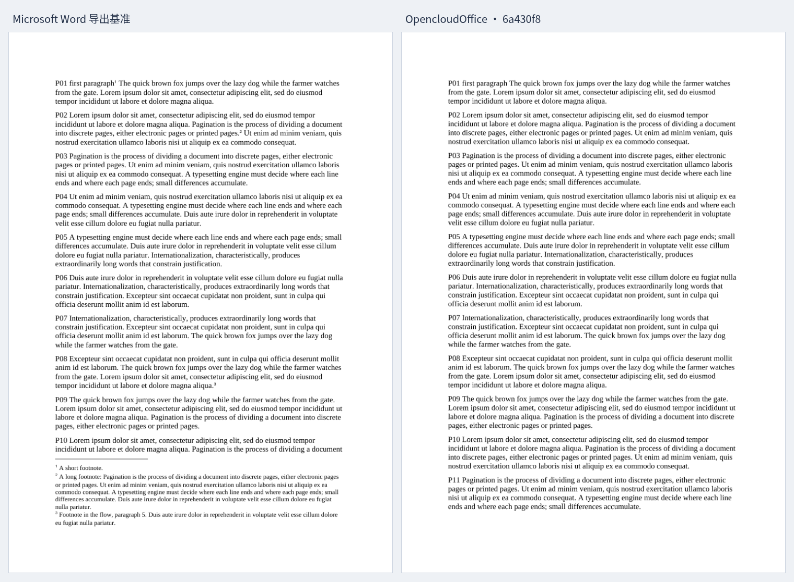
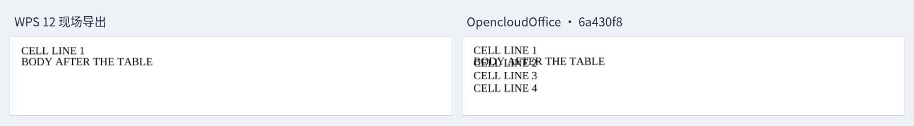
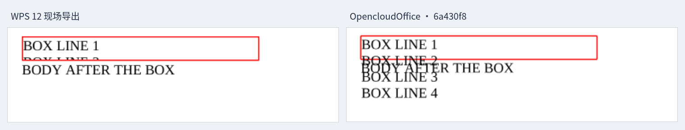
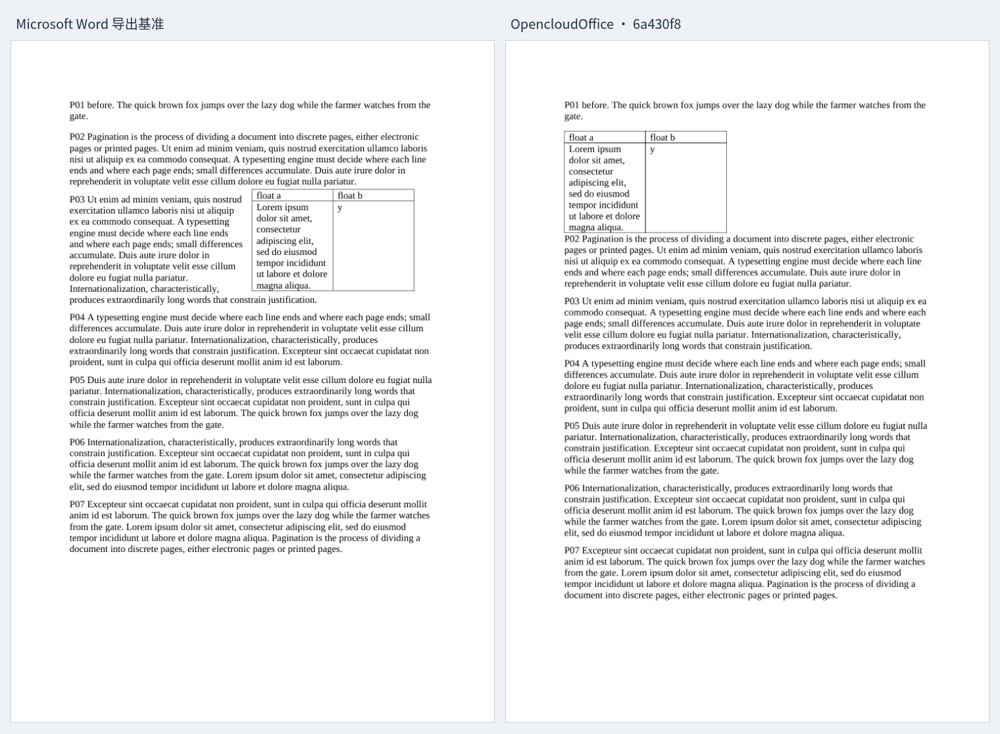
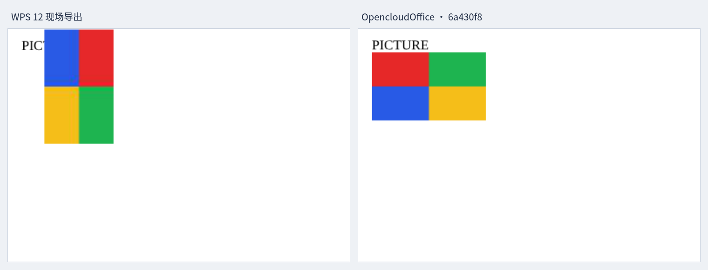
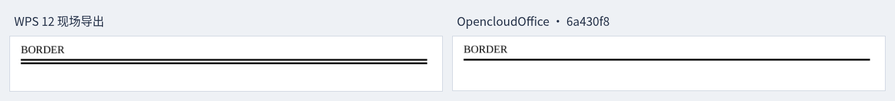

# 文档显示能力审计：Word 基准与 WPS 12 实测

日期：2026-11-14。被测代码：`codex/viewer-display` 分支的 `6a430f886f7bf800ef5b95a93fa76b5542c9d908`。

**当前已具备普通 DOCX 的阅读基础，复杂文档仍存在内容遗漏、分页错误和文字相互覆盖。建议继续集中完善显示层，暂缓编辑和写回。** 普通正文和常规表格的逐行结果较好；差距集中在脚注、中文分页边界、分栏、浮动对象、字体环境和部分绘制细节。现有行级评分还会漏掉图片方向错误、边框错误和多画出来的文字，需要同步完善验收方法。

本次增加诊断样例、测量记录和对照图，未修改排版内核。结论分别标明 Word 基准、WPS 现场结果、代码检查和待验证推断。

## 1. 对照范围和证据

| 对照对象 | 本次实际完成 | 能说明什么 |
| --- | --- | --- |
| Microsoft Word 桌面版 | 重新生成 128 份 docx4j 探针，逐份对照公开的 Word PDF，核对 7,059 行 | 对这批固定输入，比较内容、断行、分页及行坐标 |
| WPS Office for Linux 12.1.2.29183 | 安装后现场导出 26 份 PDF：11 份中文文档、14 份新诊断样例、1 份已有显示细节样例 | 验证当前 WPS 的实际显示；作为 Word 的补充参照 |
| 原生和 WASM | 对 14 份新诊断样例的 17 页逐字节比较 SVG，全部相同 | 两端表现一致；两端可以同时存在同一个显示错误 |
| 源码检查 | 检查读取、样式解析、排版、SVG 绘制和查看器提示链路 | 定位“已读取但未绘制”“布局未消费属性”等缺口 |

Word PDF 来自固定的 [docx4j 提交及其 Word 导出目录](https://github.com/plutext/docx4j/tree/c0a66b6100bb49d93dd0de005f7cdfd3784897ed/docx4j-layout-fidelity/goldens/word)。导出清单标记来源为桌面 Word，经 documents4j 调用，系统为 Windows 10。本次没有在新 Windows 实例中重新导出这些文件。该项目的[环境说明](https://github.com/plutext/docx4j/blob/c0a66b6100bb49d93dd0de005f7cdfd3784897ed/docx4j-layout-fidelity/GOLDEN-ENVIRONMENT.md)记录了 2026-10-06 使用的 Word `16.0.20430.20118`、300 dpi 默认打印机、关闭域更新和隐藏修订标记等条件；各 PDF 是历史固定导出，不把这个版本号强加给清单中每一次导出。

WPS 使用[官方 Linux 发行版](https://linux.wps.cn/)，现场 API 返回的构建号记录在 [WPS 导出清单](data/wps12-export-manifest.json)。这里的结论适用于该 Linux 构建，不外推到所有 Windows、macOS 或移动版 WPS。新诊断样例尚无 Word 导出；涉及 Word 与 WPS 可能分歧的规则，仍需补 Word 实测。

本次未重跑全部 4,725 份公开读取语料，也未新增真实客户文档。128 份 Word 探针和 11 份中文机制样例不能代表所有业务文档的通过率。所有被测输入、参考 PDF、字体文件和二进制的 SHA-256 已存入[输入清单](data/input-manifest.json)。

## 2. 实测数字及其含义

| 样本 | 页数相同的文档 | 归一化后断行相同 | 行位置相同，误差不超过 0.5 pt | 页首相同 |
| --- | ---: | ---: | ---: | ---: |
| Word：全部 128 份 | 121 / 128，94.5% | 6,557 / 7,059，92.9% | 5,577 / 7,059，79.0% | 178 / 193，92.2% |
| Word：普通正文且字体可用，28 份 | 28 / 28 | 1,241 / 1,293，96.0% | 1,133 / 1,293，87.6% | 18 / 18 |
| Word：表格类探针，34 份 | 34 / 34 | 1,775 / 1,803，98.4% | 1,731 / 1,803，96.0% | 62 / 63 |
| WPS 12：中文文档，11 份 | 10 / 11，90.9% | 599 / 746，80.3% | 397 / 746，53.2% | 19 / 31，61.3% |

数据：[Word 逐文档结果](data/word-results.json)、[WPS 中文逐文档结果](data/wps12-chinese-results.json)。Word 的 128 份中，83 份全部断行及页数一致，72 份全部行位置及页数一致。普通正文组排除了表格、图片、分节等结构，不能称作引擎全部已覆盖范围。表格组整体表现较好，仍包含后文所述的浮动表格失败案例。

**92.9% 是断行指标，不能称为“视觉还原度 92.9%”。** 当前比较器会去掉空白、部分引导线和行末中文标点，再比较行文本。位置指标只核对同页、行左端和基线，不核对行右端、逐字坐标、字形、颜色、图片、边框或裁切。Word 和 WPS 使用的样本也不同，不能据此判断哪款软件更容易兼容。

Word 全集还有 502 行未匹配到相同断行；另有 980 行虽断行相同，却未落在相同页和允许坐标范围内。这两类问题需要分开处理：前者涉及内容缺失、字宽和换行，后者更多涉及行高、分页和对象占位。

字体环境也需要保留解释：57 份 Word 探针报告缺失字体，其中 47 份涉及 Aptos；这些文档合计出现 812 行位置不一致，但不能将 812 行全部归因于字体。与仓库原有字体哈希基线相比，本机 5 个文件一致、28 个文件版本不同，没有缺失基线文件。本次逐行结果可复现，不能据此宣称完整的 `tools/fidelity/score.py` 环境校验已经通过。详见[字体环境差异](data/font-environment.json)。

## 3. 影响最大的已确认问题

### 3.1 脚注缺失，同时改变正文分页

这是 Word 基准直接确认的完整性问题。`footnotes.docx` 在 Word 中为 3 页，本项目为 2 页，99 行中只有 4 行位置一致。`page-header-footnotes.docx` 虽然双方都是 3 页，135 行中也只有 10 行位置一致。

三份相关探针 `footnotes`、`footnote-space-after`、`page-header-footnotes` 共 400 行，只有 105 行位置一致，且都没有报告缺失字体。脚注不仅少了一块注释，还减少了页底占用空间，使后面的正文提前进入当前页。这类问题会直接影响论文、法规注释和研究报告的阅读。



建议自研脚注区布局：读取注释正文和引用，计算分隔线与注释高度，反向约束正文可用高度，再处理跨页延续。尾注可复用注释正文模型，但放置规则需要单独实现。先把单栏脚注做准，再组合页眉页脚、表格和分栏。

### 3.2 中文页底容纳规则会累积成整页差异

WPS 12 的 `09-number-formats.docx` 为 9 页，本项目为 10 页；188 行中只有 20 行位置一致，后续 8 处页首均未匹配。

第一页前面的文字及基线基本一致。关键差别发生在页底：本项目把“第 100 项”推到下一页，WPS 将它放在第一页，基线约为 762.9 pt。其后的每页起点随之偏移。

只改变诊断副本的下页边距时，减少 0～4 pt 仍为 10 页，减少 5 pt 后成为 9 页，第一页也能放下第 100 项。这个实验把排查范围缩到页底的行占位和可见字形高度判断，**尚未证明具体 Word 规则**。修复应调整排版算法，不应改用户文档页边距。记录见[边界实验](data/number-boundary.json)和[第一页对照](assets/wps-09-number-formats-pair.png)。

Word 基准也有分页缺口：`page-break-line` 及四个 `page-top-space-before` 变体，Word 均为 11 页，本项目为 10 页；这些样例报告缺失 Aptos，需要先固定字体再判断兼容性开关、分页符及页顶段前距各自的影响。

### 3.3 中文空白和混排会改变合同的换行

`06-contract.docx` 双方都是 2 页，但 37 行中仅 11 行位置一致，同页匹配行的纵向误差中位数为 31.12 pt，约一个网格行距。

包含“年、月、日”和下划线留白的期限条款，本项目排成一行，WPS 排成两行；金额留白也出现类似差异。后续条款随之提前，第四条的页归属也发生变化。空白宽度、下划线空格与中西文自动间距是优先排查对象，当前还不能认定单一原因。[查看合同第一页对照](assets/wps-06-contract-pair.png)。

建议增加逐字符横坐标和下划线几何检查，分别测试连续空格、不换行空格、制表符、全角空格、下划线空白、中西文相邻和标点压缩。现在去掉空格再打分，会掩盖部分差异。

### 3.4 固定行高表格和文本框缺少裁切

诊断表格指定固定行高 12 pt，单元格内放四段文字。WPS 只显示可见的第一行；本项目继续绘制第二至第四行，第二行与表格后的正文重叠。现有逐行比较仍给它 `placed = 2 / 2`，因为参考中的两行都能找到，多画出来的三行不扣分。



文本框指定高度 20 pt、裁切溢出且不自动扩大。WPS 将超出框体的部分裁掉，本项目继续绘制完整内容，与下一段正文相互覆盖。



代码位置：[文本框布局](../../../crates/oco-layout/src/lib.rs#L1187)、[表格行高和内容布局](../../../crates/oco-layout/src/lib.rs#L559)。修复需要在绘制模型中明确裁切区域，并让可选择文字、搜索高亮和命中位置遵循同一可见区域。

### 3.5 浮动表格、分栏和旧式文本框改变整页结构

Word 的 `table-floating.docx` 中，表格浮在正文右侧，文字从左侧绕排。本项目将表格放进普通文档流，正文整体下移。双方虽都只有 1 页，46 行中只有 2 行位置一致。



新双栏样例在 WPS 中分为两栏，本项目仍按单栏排版，整体页数同为 1 页。[双栏对照](assets/wps-two-columns-pair.png)。Word 的旧式 `vml-textbox-vertical.docx` 有 43 行，本项目只匹配到 9 行断行、6 行位置。[VML 文本框对照](assets/word-vml-textbox-pair.png)。

需要分别实现分栏流、浮动表格锚定与绕排、VML 图形和文本框读取；不能通过调整普通段落间距补偿这些差异。

## 4. 页眉页脚、图片、文字、标题和编号的细节检查

| 能力 | 当前基础 | 本次确认的差距或待验证范围 | 优先级 |
| --- | --- | --- | --- |
| 页眉页脚 | 已有分节、首页和奇偶页页眉页脚，支持页码和页数格式 | 中文手册同为 10 页，但全部区域 206 行中只有 149 行位置一致，不能据此宣布整份手册显示一致；页码变长后的高度预留需专测 | P0 / P1 |
| 奇偶页分节 | 读取了 `oddPage`、`evenPage` | 奇数页分节样例 WPS 为 3 页，中间空白；本项目为 2 页。偶数页样例双方为 2 页，仅覆盖这一种起始奇偶条件 | P0 |
| 正文域 | 页眉页脚可重算 `PAGE`、`NUMPAGES`、`SECTIONPAGES` 等 | 正文两页的 `PAGE` 缓存均为 99；WPS 显示 1、2，本项目仍显示 99、99。其他正文域、目录和交叉引用需另测 | P0 / P1 |
| 图片 | 已有行内和部分浮动图片、裁切、镜像 | 90 度旋转被忽略；旋转前后的本项目 SVG 完全相同。EMF / WMF 无绘制支持；形状、组合图形、透明度和效果需要补齐 | P1 |
| 图片绕排 | 已有基础锚定和绕排 | 紧密、穿越、两侧同时绕排及多个对象遮挡仍需完善；锚定顺序和允许重叠字段已读取，排版未完整使用 | P1 |
| 普通文字格式 | 字号、粗斜体、颜色、上下标、下划线、删除线、着重号等已有实现 | 空心和阴影样例与普通文字生成完全相同的 SVG；浮雕、阴刻、字距调整等属性读取后未完整消费 | P1 / P2 |
| 边框和底纹 | 已绘制段落及表格边框、底纹，并支持部分线型 | 段落双线被画成单线；文字边框在布局样式中被简化为布尔值，无法保留完整颜色、线型和宽度 | P1 |
| 标题 | 已有样式继承、主题色、段前分页、与下段同页等基础 | 中文报告标题样例 52 行中 42 行位置一致；需要补页底标题、跨页标题、不同字体标题和目录组合验收 | P1 |
| 编号 | 已有多级编号、多种数字格式、标签字体及缩进 | 中文编号样例受页底规则影响发生整页偏差；还需检查 9→10、99→100、重启、样式关联、长标签换行与不同文本区域计数 | P0 / P1 |
| 表格 | 普通常规表格已有较好的逐行结果 | 固定行高裁切、浮动表格、条件样式、竖排文字、边框冲突规则、单元格禁止换行和适应文字尚不完整 | P0 / P1 |
| 字体与文字方向 | 自研 TrueType / CFF 解析、替换度量、字形轮廓绘制 | 缺少完整 GSUB / GPOS、字距调整和复杂文字塑形；双向文字及竖排尚不足；嵌入字体读取、可变字体等需补充 | P1 / P2 |
| 注释、公式和对象 | 可识别部分未支持内容 | 脚注、尾注、批注显示、公式、图表、SmartArt、OLE 和修订标记视图缺口明显 | 脚注 P0，其余按业务排期 |

P0 指会造成内容遗漏、页归属错误、文字覆盖或错误的能力提示；P1 指常见版式和可见格式差异；P2 指需要较大专项实现、且当前业务覆盖尚未充分测量的能力。它们是本次审计给出的实施顺序，不是对所有文档出现频率的统计。

### 图片旋转与线型：文字分数相同，外观不同

下面两个问题都可能得到满分的文字位置指标。旋转样例中，本项目忽略了图片变换；双线边框样例中，本项目只画一条线。





代码位置：[图片属性只保留裁切和镜像](../../../crates/oco-docx/src/drawing.rs#L46)、[边框绘制](../../../crates/oco-layout/src/lib.rs#L881)。应先在文档模型中保留变换、线型及效果参数，再将这些参数贯穿到排版包围盒和绘制过程。

### 空心字、竖排：可见结果与 PDF 文本抽取不能混为一谈

WPS 的空心字 PDF 采用轮廓绘制，文本抽取为零行，但页面上清楚可见文字。本项目仍画成普通实心字。给这个样例计算一个“0 行”的文本分数，无法评估显示是否正确。


单元格竖排样例则直接显示为横排。[竖排单元格对照](assets/wps-table-vertical-text-pair.png)。源码的[布局文字样式](../../../crates/oco-layout/src/paragraph.rs#L159)没有保存空心、阴影等效果，[字体解析范围](../../../crates/oco-layout/src/sfnt.rs#L1)也明确未覆盖塑形表和字距调整。多语言和竖排需要独立的文字布局工作，单纯替换字体无法完成。

### 页眉页脚还有一个需要验证的组合问题

当前页眉页脚预留高度时使用保存的域结果，最终绘制时才替换页码、总页数和分节页数。代码见[页框计算](../../../crates/oco-layout/src/lib.rs#L1946)及[域替换](../../../crates/oco-layout/src/lib.rs#L2643)。如果页码从一位增长到三位，或者罗马数字使整行变长，最终可能换行而预留高度没有同步改变。这是代码检查发现的风险，本次尚未用 Word 样例证明发生了重叠。应加入窄页眉、长页码和首页不同页眉的组合样例。

## 5. 查看器目前会漏报已知显示缺口

14 份诊断样例调用实际 WASM 的 `info()`，返回的 `missingFonts`、`notShown`、`warnings` 全部为空。它们包含已确认忽略的分栏、旋转、空心字、双线边框和奇数页分节，因此查看器会显示“没有发现已知会造成差异的内容”。数据见[能力提示结果](data/probe-warnings.json)。

分栏的原因已定位：读取层记录 `w:sectPr/w:cols (more than one column)`，WASM 分类器却用 `ends_with("w:sectPr/w:cols")` 匹配，后面的说明文字使匹配失败。其他属性还有“读取器认识，但排版器没有实现”的情况，无法仅凭未知 XML 标签计数判断支持程度。代码见[分栏记录](../../../crates/oco-docx/src/section.rs#L167)、[WASM 分类](../../../crates/oco-wasm/src/lib.rs#L368)和[查看器提示](../../../web/viewer.js#L473)。

建议建立从文档特征到渲染能力的明确映射，区分完整显示、近似显示和未显示。检测应由实际采用的布局路径报告，并附页码或对象位置。这属于显示可信度，应与显示修复一起完成。

查看器已有后台排版、按可见页绘制、全文搜索、跳页和缩放保持位置。加载方面仍按固定字体集合执行。本次字体索引有 53 项、51 个不同文件，去重后文件共 82,259,664 字节，约 78.4 MiB；网络缓存会影响实际传输量。后续应按文档字体需求加载、记录首屏时间和峰值内存。本次未测移动设备，也未给出大文档性能达标结论。

## 6. 格式范围：DOCX 的成绩不能用于 DOC 和 Markdown

当前已完成主要显示链路的是 DOCX。[DOC 转换入口](../../../crates/oco-doc/src/lib.rs#L45)仍返回 `Unsupported("the binary Word format is not read yet")`；[Markdown 入口](../../../crates/oco-markdown/src/lib.rs#L24)只是每行转成一个普通段落，还没有标题、列表、表格、代码块和图片解析。

因此，DOC 容器、二进制正文与格式读取仍是独立开发任务。自研 ZIP、XML 和字体解析的成果已经成立，但不能由此推出二进制 DOC 显示已经完成。建议先稳定 DOCX 显示和统一模型，再分别建立 DOC 与 Markdown 的输入、转换及显示验收集。

## 7. 建议的实施顺序

### 第一轮：保证内容可读、页归属正确，并让测量发现错误

1. 实现固定行高单元格和文本框裁切，消除文字覆盖；检查裁切后的选择层和搜索位置。
2. 修正奇偶页分节和正文页码；补三位页码、分节重启、首页不同页眉等组合样例。
3. 固定字体后，解决中文页底行容纳和页顶段前距；逐字符定位合同留白和混排换行差异。
4. 修复未支持内容提示，并让评分记录多余内容、遗漏内容、对象几何和外观差异。

这一轮以本报告中的具体失败样例关闭为验收条件。WPS 独有结论先保留为兼容性分支，补 Word 导出后再确定通用规则。

### 第二轮：补齐决定整页布局的结构

先做脚注正文、引用、分隔线和跨页延续，再做分栏、连续分节和脚注组合。随后完成浮动表格、图片两侧绕排、对象遮挡顺序和 VML 文本框。常规表格继续补条件样式、重复表头组合、单元格方向及边框冲突。

这些能力直接决定正文流经哪些区域。建议在自研布局模型中明确页正文、栏、注释区、表格单元格和文本框各自的可用区域、溢出规则及绘制顺序，减少不同对象分别维护一套不一致的规则。

### 第三轮：补齐可见格式与字体细节

完善图片旋转及组合变换、双线和复合边框、文字边框、空心和阴影。标题和编号优先验证样式继承、字体变体、长标签、重启及与分页的组合。字体方面先保证常用中文业务字体和替代字形的可解释性，再扩展自研塑形、双向文字、竖排和嵌入字体。

核心继续在本项目实现：DOC/DOCX 容器、压缩、XML、字体、文档模型、排版和绘制都保持自研；Rust 内核和 WASM 不增加第三方 crate。Python、PDF 读取器、浏览器自动化、Word 和 WPS 用于生成参考和核对结果，不进入产品内核。

### 何时可以把主要精力转向操作和编辑

建议先满足以下条件，再转向编辑和写回：

- 本报告中会遗漏正文或注释、覆盖文字、错误分页的 P0 样例全部有回归检查，原生与 WASM 一致。
- 冻结 Word 版本、字体文件、打印机及导出选项；新增中文样例的 Word 基准，明确记录与 WPS 的差异。
- 普通正文、复杂表格、公文、合同、论文、报告分别有真实文档验收，检查首页、中间页、末页和跨页结构。
- 逐文档基线无未解释的下降；任何新回归都能定位到具体文档、页面和属性，不能用总分提高抵消。
- 可见文字无意外遗漏或重复，图片、注释、边框和裁切有独立检查；未实现能力有准确提示。
- 在明确设备和网络条件下完成首屏、长文档滚动、字体加载和内存测试，给出可重复的结果。

当前尚未满足这些条件。现阶段继续投资显示层，收益最明确。

## 8. 测试工具需要补的检查

现有[逐行比较器](../../../tools/common/layout_lines.py#L185)适合发现换行和基线差异，但至少需要补四类检查：

| 检查 | 当前盲点 | 建议记录 |
| --- | --- | --- |
| 内容完整性 | 只统计参考行能否找到；多绘制的内容可能不扣分 | 遗漏、重复、顺序错误、域值错误，双向比较 |
| 字符与对象几何 | 只比较行左端和基线 | 行右端、逐字位置、图片变换、对象框、裁切范围 |
| 外观 | 图片、字形、线型、颜色和填充不计分 | 同比例页面栅格图及局部差异；抗锯齿差异单独容忍 |
| 参照完整性 | PDF 文本抽取看不到轮廓字；空白页和正文区域判定也有限制 | PDF 页数、视觉内容、文字抽取和对象结构交叉核对 |

页首指标目前借用本项目的正文边界去判断参考 PDF 的正文区域，页眉高度出错时可能一起误判。图像比较也不能单独承担验收，需要与文字、对象几何和人工检查结合。

另外，[WPS 导出脚本](../../../tools/wps/export.py#L172)在 `finally` 中调用 `os._exit(status)`，普通异常未设置非零状态时会被吞掉，导致没有导出文件也可能返回成功。本次用捕获普通异常的外层入口执行，并逐份核对 26 个 PDF 和清单；后续应正式修复工具，并把预期输入数量、实际导出数量和异常状态加入检查。

## 9. 复现与附件

新增样例生成器：[tools/audit/display_probes.py](../../../tools/audit/display_probes.py)。生成的 DOCX 是输入，WPS / Word 导出才是相应参照。生成器使用开发侧 Python 标准库，不改变产品依赖。

在准备好仓库开发依赖、项目字体、Word 公开基准和 WPS 后，可按下列入口复测：

```sh
python3 tools/audit/display_probes.py
cargo build --release -p oco-cli
tools/web/build.sh
node tools/web/check.mjs out/display-audit/probes/*.docx

# Word 基准：首次需要 JDK、Maven，以及生成器实际可见的 Liberation / Carlito / DejaVu。
tools/corpus/docx4j_probes.sh
python3 tools/word/compare.py corpus-word/docx4j --json out/word-audit.json

# WPS 使用独立配置与可用的 X 显示，导出前确认字体和构建号。
python3 tools/wps/export.py out/display-audit/probes
python3 tools/word/compare.py out/display-audit/probes --reference wps --json out/wps-audit.json
```

WPS 12 的自动化需要独立组件模式 `AppComponentMode=prome_independ`，本次使用隔离配置目录和虚拟 X 显示。它使用随安装包提供的运行库；旧版 WPS 的替换运行库办法不适用于本次构建。导出成功必须以实际 PDF、逐行文件和清单数量为准。完整 26 份的目录由 11 份 `testdata/zh-open`、14 份生成样例和 `testdata/details/display-details.docx` 组成。

| 附件 | 内容 |
| --- | --- |
| [输入与环境清单](data/input-manifest.json) | 提交、输入 / PDF / 二进制 / 字体哈希 |
| [Word 结果](data/word-results.json) | 128 份逐文档指标 |
| [Word 分类结果](data/word-groups.json) | 按文件名前缀划分的诊断类别，互斥但不代表业务分布 |
| [WPS 12 全部结果](data/wps12-results.json) | 26 份逐文档指标；轮廓文字等样例不能仅靠此指标判断 |
| [WPS 12 中文结果](data/wps12-chinese-results.json) | 11 份中文文档的独立汇总依据 |
| [WPS 导出清单](data/wps12-export-manifest.json) | 实际版本、导出方式及 PDF 使用字体 |
| [诊断问题](data/probe-questions.json) / [本项目输出](data/probe-ours.json) | 14 份诊断样例的目的、文字及 SVG 哈希 |
| [WASM 提示结果](data/probe-warnings.json) | 未支持内容漏报的直接证据 |
| [原生 / WASM 检查](data/native-wasm.txt) | 14 份、17 页、0 差异、0 打开失败 |
| [字体差异](data/font-environment.json) / [页底边界实验](data/number-boundary.json) | 环境限制及分页诊断依据 |

对照图由参考 PDF 和本项目 SVG 按相同页面单位渲染，局部图使用相同裁切区域。Word 图使用其固定 PDF，不代表本机 Word 窗口截图；WPS 图使用本次现场导出的 PDF。
