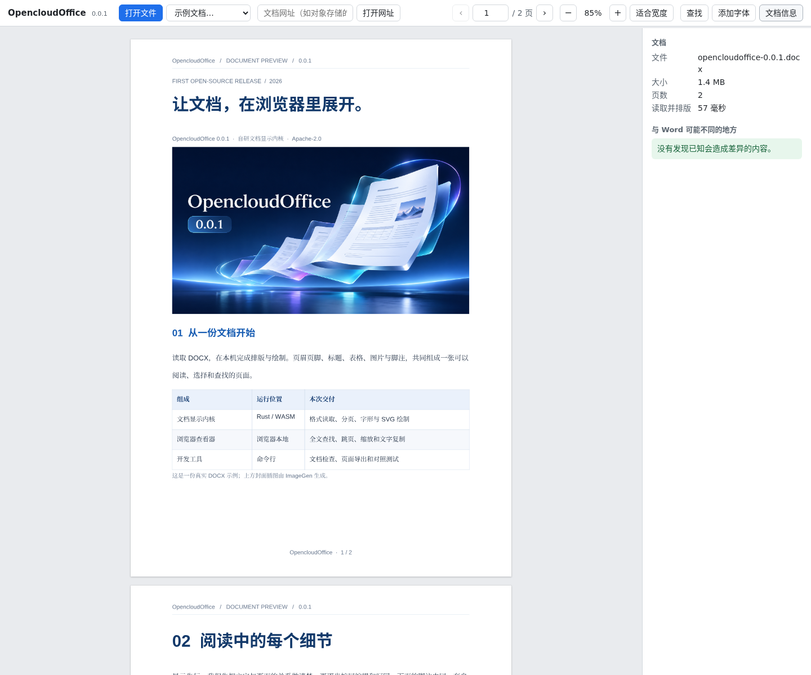
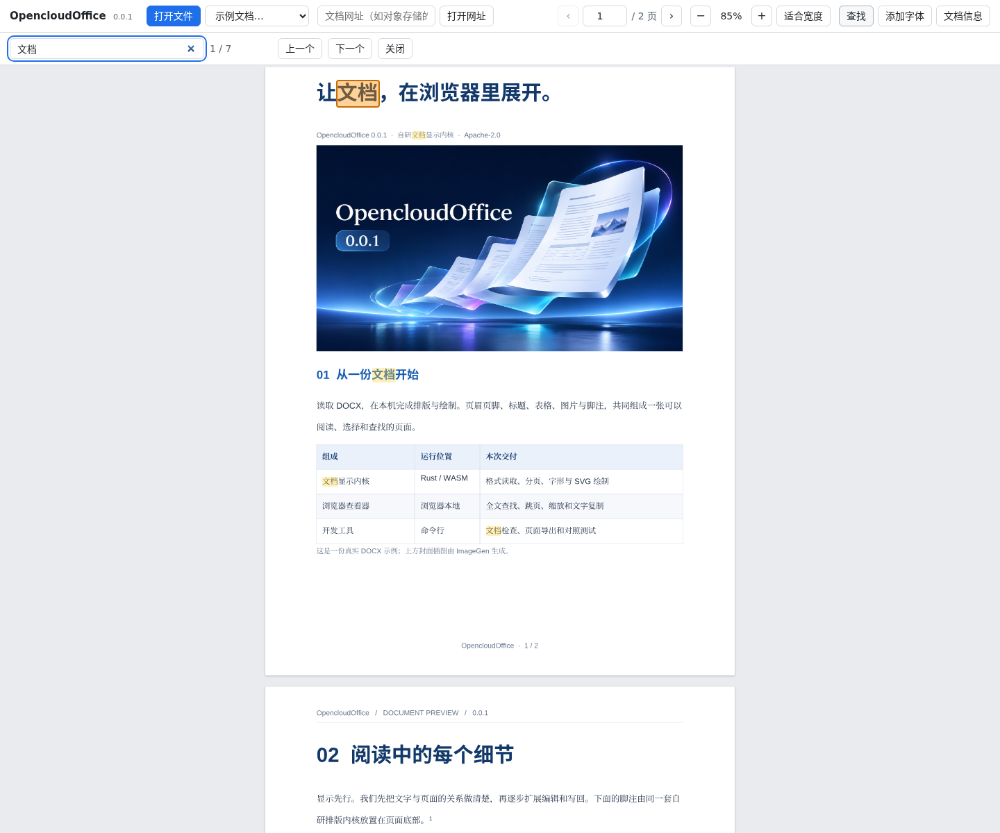
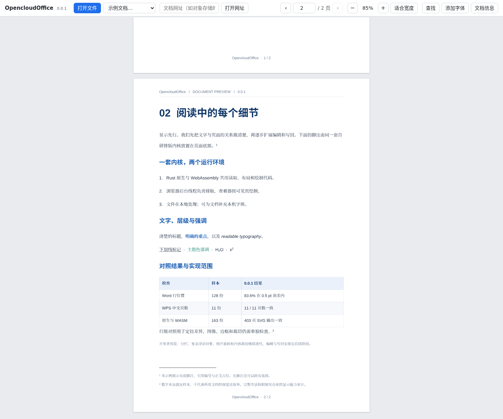

# OpencloudOffice 0.0.1

OpencloudOffice 的首个开源版本，采用 **Apache-2.0**，由 `main` 维护。

这一版交付自研 DOCX 显示内核、浏览器查看器、WASM SDK 和命令行工具。版本定位是开发者预览：先完善文档显示，编辑和写回安排在后续阶段。


上图为 ImageGen 生成的产品概念图。

## 实机截图

截图来自当前查看器在 Chromium 中运行真实 DOCX 的结果，示例文档和截图脚本随源码提供。







## 下载和试用

| 文件 | 用途 |
| --- | --- |
| `opencloudoffice-0.0.1-web.zip` | 浏览器试用包，包含查看器、WASM、开源字体和示例文档 |
| `opencloudoffice-0.0.1-wasm-sdk.zip` | 用于集成的 WASM 和 JavaScript 接口；字体由调用方提供 |
| `opencloudoffice-0.0.1-linux-x86_64.tar.gz` | Linux x86_64 命令行工具，在 Ubuntu 22.04 上构建；字体单独提供 |
| `SHA256SUMS` | 以上三个文件的 SHA-256 校验值 |

解压浏览器试用包，在解压后的目录运行：

```sh
python3 -m http.server 8000 --bind 127.0.0.1
```

打开 `http://localhost:8000`，选择发布示例，或打开本地 DOCX。需要通过 HTTP 访问，不能直接用 `file://` 打开。运行试用包不需要 Rust，文档在浏览器本地处理。

## 已实现

- 自研 ZIP / DEFLATE、XML、TrueType / CFF 字体解析、文档模型、排版和 SVG 绘制。
- 正文、标题、编号、常规表格、页眉页脚、页码、图片与基础文本框显示。
- 页底脚注、文末尾注、脚注跨页，以及按页、按节重新编号。
- 后台线程排版、按可见页绘制、全文查找、高亮、跳页、缩放、文字选择与复制。
- 原生和 WASM 共用内核；默认内核及 WASM 不依赖第三方 crate。

## 验证范围

发布准备期间，在 Rust 1.88.0 上运行测试，通过 191 项测试。显示内核与 `1f24e5c` 保持一致，继续保留以下固定语料结果：

| 对照 | 断行一致 | 行位置一致（≤ 0.5 pt） | 页数一致 |
| --- | ---: | ---: | ---: |
| Word 的 128 份固定 PDF 基准 | 94.1% | 83.6% | 122 / 128 |
| WPS 12 的 11 份中文样例 | 80.3% | 73.7% | 11 / 11 |

原生与 WASM 对 163 份文档、403 页的 SVG 输出逐字节一致。三份 Word 脚注样例的 400 行全部落在允许误差内。

发行包另以自带的 37 个字体文件核对 3 份文档、8 页，命令行与 SDK 的 SVG 全部相同；106 个文件清单项通过大小和 SHA-256 检查。浏览器集成检查覆盖全文查找、跳页、缩放、复制、文件切换、字体添加和移动窗口布局，全部通过。

这些是固定字体环境下的行级指标，不是所有文档的视觉还原率。发行包采用明确许可的 37 个字体文件，包含 Liberation 2；历史基准使用的开发字体版本可能不同。字体清单、哈希和许可保存在各发行包中。

## 已知限制

- DOC 二进制读取尚未实现；Markdown 目前仅转换成普通段落。Excel、PPT 和 PDF 不属于本版输入范围。
- 编辑、修订操作和写回尚未实现；接口可能随后续版本调整。
- 分栏、浮动表格、旧式 VML 对象和复杂文字塑形尚不完整。
- 图片旋转、部分边框和文字效果、固定高度内容裁切仍需改进。
- 正文页码域可能沿用保存值，奇偶页分节尚未补齐。
- 合同样例相对 WPS 仍存在空白和换行差异；网格规则改善总体分页后，该样例的纵向偏差中位数从 31.12 pt 增至 62.32 pt，继续单独跟踪。

## 许可证与贡献

源代码采用 Apache-2.0。字体和命令行依赖保留原许可，原始声明随发布包提供。欢迎提交带最小示例的显示问题，或通过独立分支提交 Pull Request。
